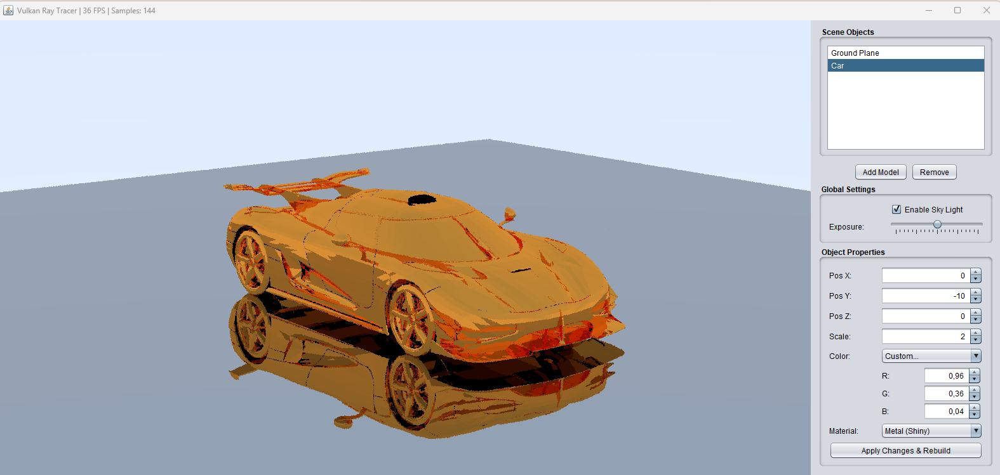
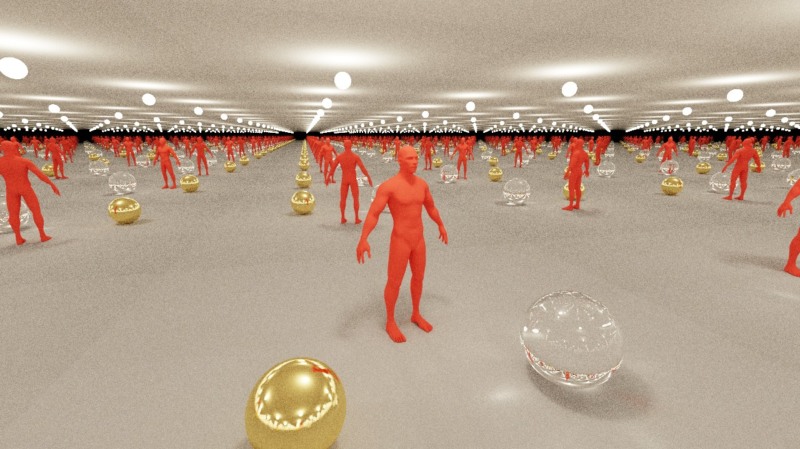
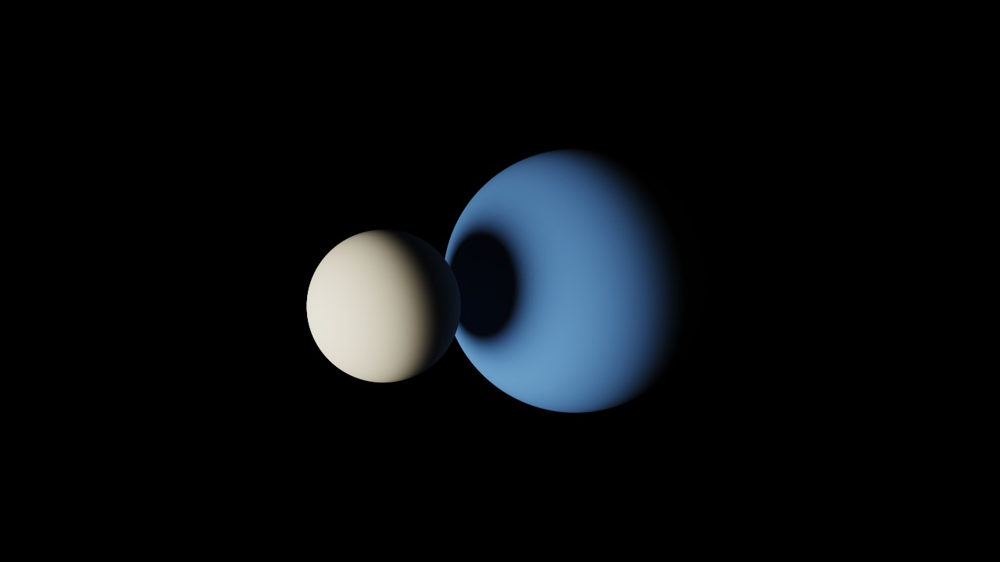
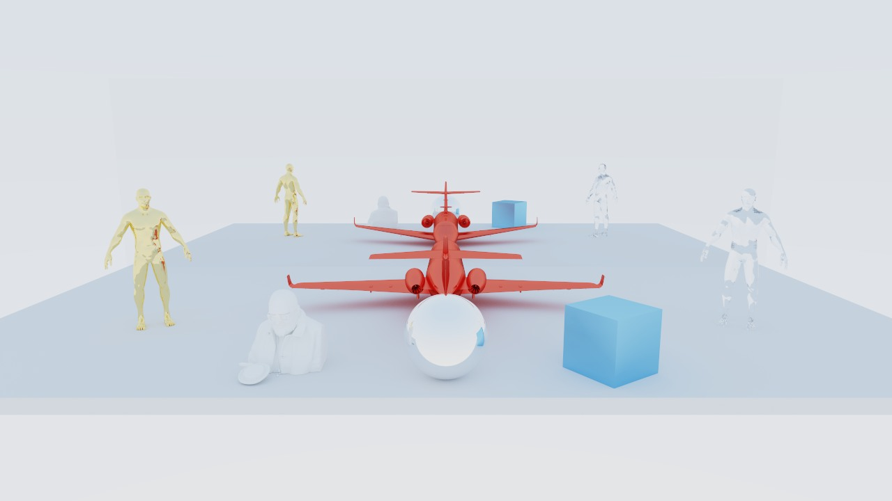
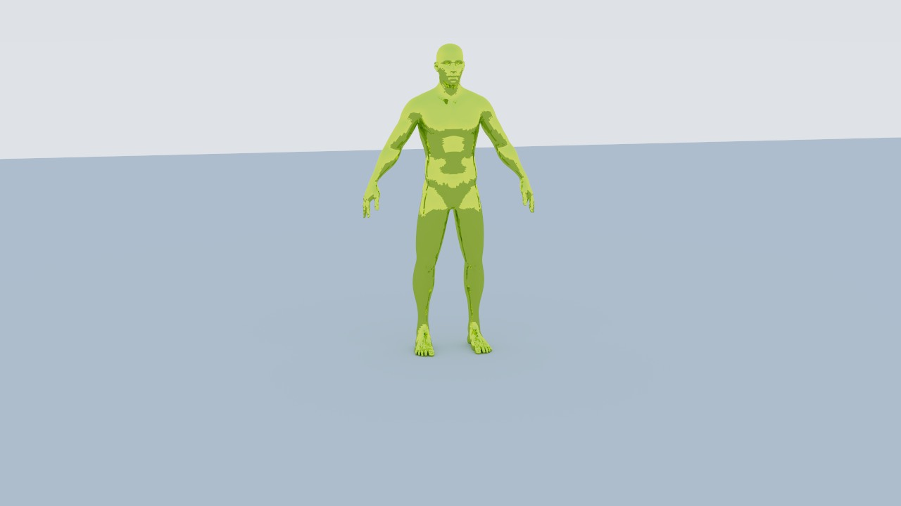
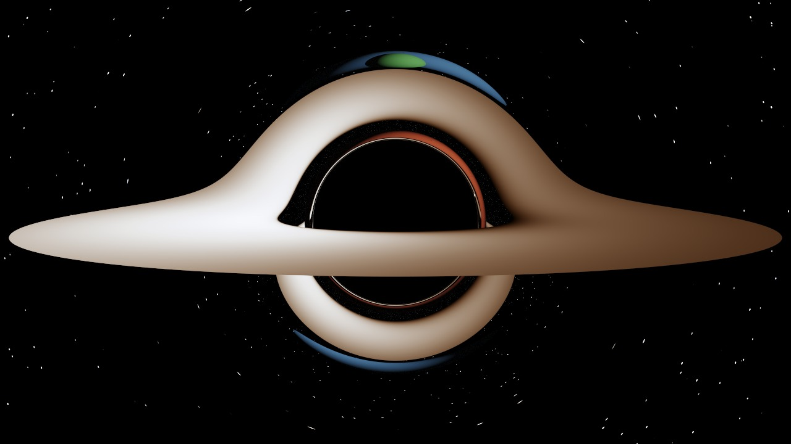
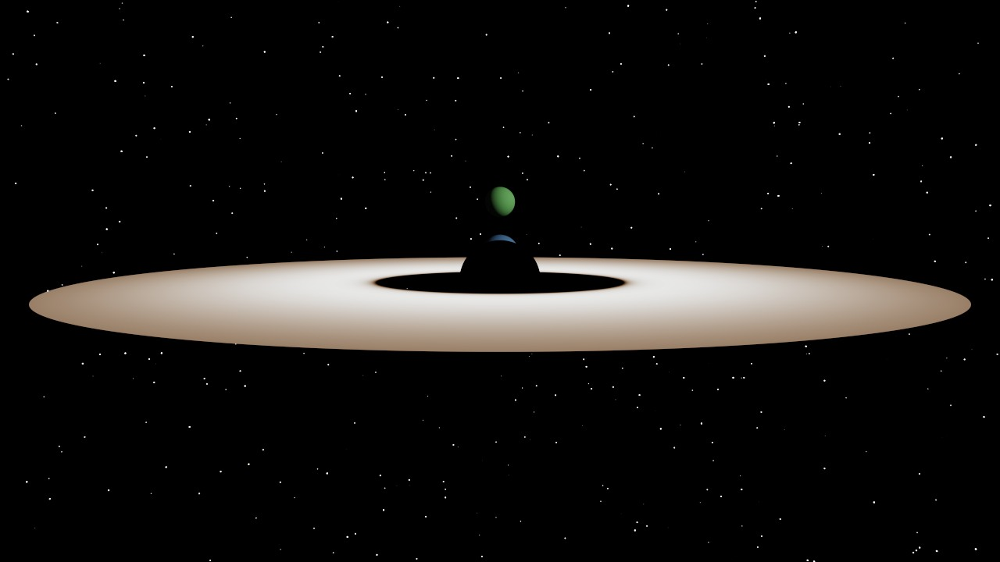
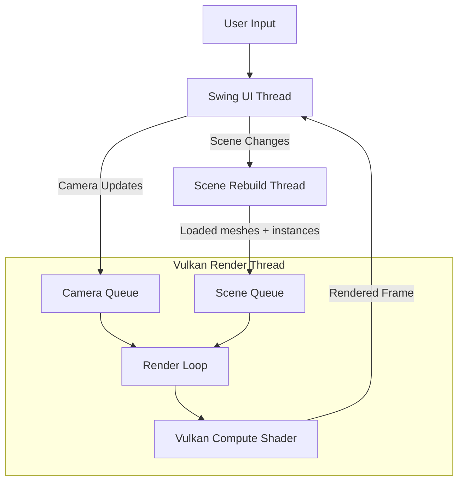

# Gpu Based 3D Ray Tracer 


**Author:** Demir Demirdöğen

> **Work in Progress:** This project is actively under development. Features, render techniques, and UI elements are subject to change as new capabilities are implemented (next: a denoiser for moving cameras and a rotating Kerr black hole).

A high-performance, real-time **GPU Ray Tracer** written in Java using **LWJGL** and **Vulkan**.

This project, developed as a **Software Engineering Student Project**, demonstrates a robust, multi-threaded architecture capable of rendering complex 3D scenes. It uses the GPU's **hardware ray tracing units (RT cores)** through Vulkan ray queries: the driver builds the acceleration structures on the GPU, and a compute shader path-traces the scene against them. (Earlier versions used a custom CPU-built BVH traversed in the shader; see the [development log](DEVELOPMENT_LOG.md).)

### [➔Click here to visit the Render Gallery ](GALLERY.md)



##  Key Features

* **Hardware Ray Tracing:** A Vulkan compute shader traces rays with `rayQueryEXT` against a top-level acceleration structure (TLAS) of instances, each pointing at a bottom-level structure (BLAS). Traversal and triangle tests run on the RT cores.
* **Meshes and Analytic Spheres:** `.obj` meshes become triangle BLASes; spheres are a single AABB whose exact intersection is computed in the shader, so they stay perfectly round.
* **Instancing:** Each model file becomes one BLAS in VRAM, shared by every copy in the scene. Moving, scaling or recoloring objects only rebuilds the TLAS (a few milliseconds).
* **Path Tracing:** Progressive accumulation (the image keeps refining until a sample limit), materials **Matte**, **Metal** (roughness 0 = mirror), **Glass** (refraction, Fresnel) and **Light** (emissive), direct light sampling with shadow rays towards spherical lights, Russian roulette, ACES tone mapping and exposure.
* **Animation:** Objects can orbit other objects (or the origin) and spin; orbits nest (a moon around a planet around a sun). The TLAS is rebuilt on the GPU inside every frame.
* **Black Hole:** Camera rays follow exact Schwarzschild light paths (RK4 integration, each step traced as a ray query), with a relativistic accretion disk (gravitational and Doppler shift, g⁴ beaming). Verified against known results: the rendered shadow is 171.0 px for a predicted 171.4 px.
* **Multi-Threaded Architecture:**
    * **UI Thread:** Responsive Swing Interface (never freezes).
    * **Vulkan Render Thread (VRT):** Dedicated rendering loop with two frames in flight; the only thread that makes Vulkan calls.
    * **Scene Rebuild Thread (SRT):** Loads new model files in the background (cached per file) for non-blocking scene editing.
* **Editor:** Scene presets, an object pool, an object list and live object settings (position, rotation, scale, material, animation). Every change shows up immediately.

##  Scenes

| Mirror Room | Eclipse |
|---|---|
|  |  |
| A closed room with mirror walls and one small lamp: 30 bounces of reflections. | A sun, planets and a moon. The moon orbits Earth; once per orbit its shadow falls on Earth (shadow rays towards the sun). |
| **ShowRoom** | **Custom** |
|  |  |
| Models on a platform in front of a mirror wall, lit by the sky. The airplane can turn like on a display turntable. | A ground plane and a figure: the starting point for your own scene. |
| **Black Hole** | **Black Hole without gravity** |
|  |  |
| Light bent around a Schwarzschild black hole: the far side of the accretion disk shows above and below the shadow, a planet hidden behind the hole appears as Einstein arcs, the approaching side of the disk is brighter (Doppler beaming). See [docs/black-hole.md](docs/black-hole.md) for the physics and its verification. | The same scene with straight light rays, for comparison: the horizon is a black sphere and the planet behind it is hidden. |

##  System & Performance

**Tested System Specs:**
* **OS:** Windows 11 Pro
* **CPU:** AMD Ryzen 5 7600X
* **GPU:** NVIDIA GeForce RTX 5060 Ti (16 GB)
* **RAM:** 48 GB

**Measured GPU time per frame** (1280×720, 1 sample per pixel, up to 10 bounces):

| Scene | Previous CPU-built BVH | Hardware ray tracing |
|---|---|---|
| ~49k triangles | 29 ms | 0.6 ms |
| ~1M triangles (20 instanced meshes) | 1129 ms | 0.7 ms |

Building the acceleration structures for the default scene takes about 17 ms on the GPU (the CPU BVH took 0.4 s). With two frames in flight the renderer produces about 2000 frames per second on the default scene; the window shows the newest one at the monitor's refresh rate, and the extra frames go into accumulation. The window title shows render FPS, GPU time per frame (from timestamp queries), display FPS and accumulated samples.

##  Architecture Overview

The application is built on a "Decoupled Rendering" model to ensure the UI remains responsive even while models are loading.



##  Controls

### Camera
* **Drag (left mouse button):** Orbit around the point the camera looks at
* **Mouse wheel:** Zoom in / out
* **W / S, A / D, Q / E:** Move forward / back, left / right, up / down (camera and target together)

### Side Panel
* **Scene:** Load a preset (Custom, Mirror Room, Eclipse, ShowRoom, Black Hole, Black Hole: Shadow); sky light, maximum bounces, exposure, sample limit (rendering stops when reached, 0 = never), *Play animation* and *Gravity bends light* (black hole scenes).
* **Object pool:** The sphere primitive and the models in `objects/`. *Add* (or double-click) places one where the camera looks; *Browse...* adds any `.obj` file.
* **Objects:** The objects in the scene, with *Duplicate* and *Remove*.
* **Object settings:** Name, position, rotation, scale, material (color, roughness, light brightness, index of refraction) and animation (orbit center, orbit period, spin period) of the selected object.

##  Technical Details

* **Language:** Java 21
* **Graphics API:** Vulkan 1.2 with `VK_KHR_acceleration_structure` and `VK_KHR_ray_query` (via LWJGL 3.3.6)
* **Shading Language:** GLSL 4.60 (`GL_EXT_ray_query`, `GL_EXT_buffer_reference`), compiled to SPIR-V with shaderc at build time.
* **Acceleration Structures:** One BLAS per mesh (vertex and index buffers in VRAM, read in the shader through buffer device addresses) or per sphere (one AABB), one TLAS over all instances, all built on the GPU by the driver. For animated scenes the TLAS is rebuilt in every frame's command buffer from that frame's instance buffer.
* **Frame Pipeline:** Two frames in flight; the shader writes BGRA so the frame copied back from cached host memory goes straight into a `TYPE_INT_RGB` image; GPU time is measured with timestamp queries. Animation time advances in 1/60 s steps, so frames rendered within one step still accumulate.
* **Synchronization:** Explicit memory barriers and layout transitions (General <-> Transfer) between the compute pass and the copy of the frame to the CPU.

##  Build & Run

### Prerequisites
* **Java:** JDK 21.
* **GPU:** Hardware ray tracing through Vulkan 1.2 (`VK_KHR_acceleration_structure` + `VK_KHR_ray_query`), e.g. NVIDIA RTX 20 series or newer, AMD RX 6000 / RDNA2 or newer, Intel Arc. The Vulkan runtime comes with the GPU driver; the Vulkan SDK is only needed for validation layers.
* **Build Tool:** None to install. The project uses the Gradle wrapper, which downloads Gradle and LWJGL on the first build.

### Running
```bash
./gradlew run          # Windows (cmd/PowerShell): gradlew run
```

Shaders live in `src/main/shaders/` and are compiled to SPIR-V during the build (Gradle task `compileShaders`, using shaderc through LWJGL), so no Vulkan SDK or `glslc` is needed. The default scene uses models from `objects/`.
To turn on Vulkan validation (requires the Vulkan SDK), run `./gradlew run -Dvulkan.validation=true`.

To get a standalone build: `./gradlew installDist`, then start `build/install/ray-tracer-vulkan/bin/ray-tracer-vulkan` from the repository root (shaders and models are loaded relative to the working directory).

In IntelliJ IDEA, open the folder and let it import the Gradle project.

##  Development Log

For a detailed history of the project's evolution, technical hurdles, and future roadmap (Path Tracing implementation), please see the [DEVELOPMENT_LOG.md](DEVELOPMENT_LOG.md).

*Powered by LWJGL and Vulkan.*

