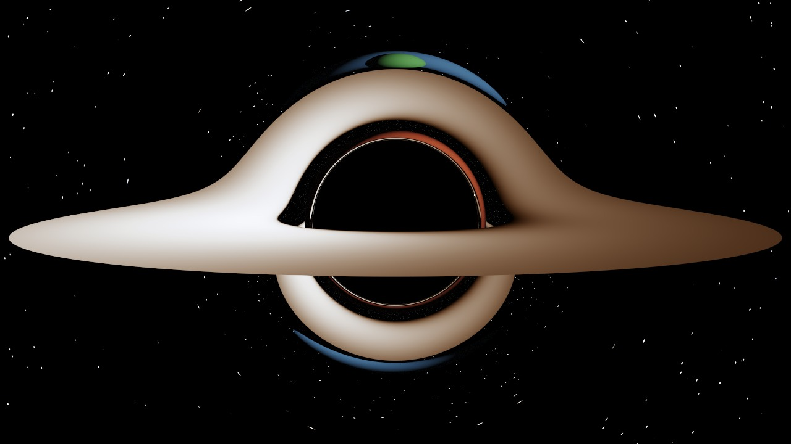
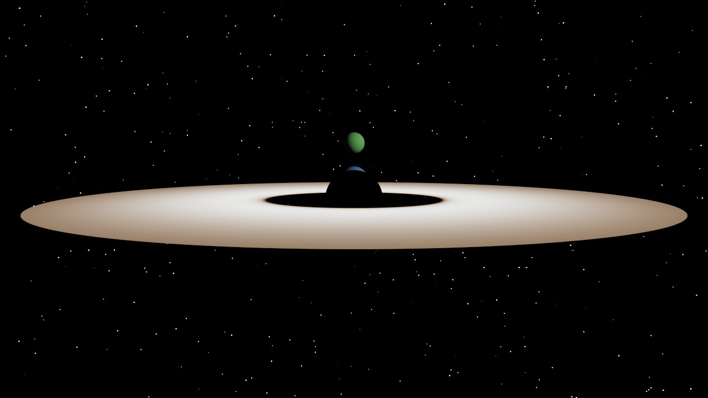
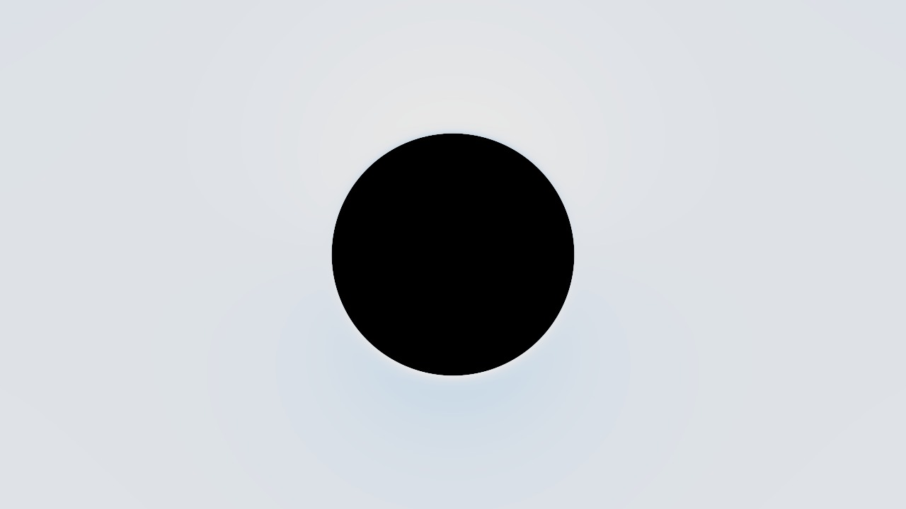

# Black Hole: Physics, Implementation and Verification

The **Black Hole** scene renders a non-rotating (Schwarzschild) black hole with a thin accretion
disk. Light rays are bent by integrating the exact equations of motion of light in Schwarzschild
spacetime; the result is checked against known results, both in unit tests and on the rendered image.

Units: G = c = 1, black hole mass M. The event horizon is at r = 2M.

| With gravity | Without gravity (straight rays) |
|---|---|
|  |  |

## 1. Light paths around a black hole

Schwarzschild metric:

    ds² = -(1 - 2M/r) dt² + (1 - 2M/r)⁻¹ dr² + r² dΩ²

By spherical symmetry a light ray stays in one plane. The conserved energy E and angular momentum L
give the impact parameter b = L/E. The null condition gives

    (dr/dλ)² = E² - (L²/r²)(1 - 2M/r)                                    (1)

and with u = 1/r and dr/dλ = -L du/dφ:

    (du/dφ)² = 1/b² - u²(1 - 2Mu)                                        (2)
    u'' + u = 3M u²         (differentiate (2) by φ and divide by 2u')    (3)

Consequences used below:

- **Photon sphere:** a circular orbit has u' = u'' = 0, so u = 3Mu², **r = 3M**.
- **Critical impact parameter:** V(u) = u²(1 - 2Mu) peaks at u = 1/(3M) with V = 1/(27M²), so rays with
  **b < b_c = 3√3 M ≈ 5.196 M** fall in and rays with b > b_c escape.
- **Shadow size** seen by a static observer at distance r_o (Synge 1966):
  **sin α = 3√3 M √(1 - 2M/r_o) / r_o**.
- **Weak-field deflection:** α = 4M/b + (15π/4)(M/b)² + O((M/b)³).

## 2. The form used on the GPU

In Cartesian coordinates x centered on the hole, with velocity v:

    dx/dλ = v,     dv/dλ = -3 M h² x / r⁵,     h = |x × v| (constant)    (4)

**Why this is exact.** For a central acceleration f(r), h = |x × v| is conserved and the path obeys
Binet's equation u'' + u = f / (h²u²). With f = 3M h² u⁴ the right side is 3M u², which is (3). Also
a·v = M h² d(r⁻³)/dλ, so C = ½|v|² - M h²/r³ is conserved; with |v|² = (dr/dλ)² + h²/r² this gives
(dr/dλ)² = 2C - (h²/r²)(1 - 2M/r), which is (1) with E² = 2C and L = h. So (4) traces the exact spatial
path of a light ray in Schwarzschild coordinates.

**Starting direction.** The camera is a static observer. A ray it sees leaving in local direction n
(components n_r radial, n_⊥ sideways) has dr/dλ = n_r √(1 - 2M/r) and r dφ/dλ = n_⊥ (in its local
frame e_r̂ = √(1 - 2M/r) ∂_r). So the integration starts with

    v₀ = n - (1 - √(1 - 2M/r₀)) (n · r̂) r̂

Check: h = r₀ n_⊥, 2C = (1 - 2M/r₀)(n_r² + n_⊥²) = 1 - 2M/r₀ = E², hence b = r₀ n_⊥ / √(1 - 2M/r₀),
the known result. Without this correction the shadow would be about 2.5% too small at r₀ = 40M.

**Capture.** A ray inside the photon sphere (r < 3M) that moves inward never turns back: from (2),
(du/dφ)² = 1/b² - V(u), V decreases for u > 1/(3M), and 1/b² ≥ V(u) already holds, so there is no turning
point before the horizon. Escaping rays always turn around outside 3M.

## 3. Implementation

Everything lives in `src/main/shaders/pathtrace.comp`; the black hole only changes the camera ray, so
materials, light sampling, accumulation and animation work as in every other scene.

- **Ray marching:** the camera ray is integrated with RK4 using (4), step dλ = 0.02 r. Each step is a
  straight chord, traced with a **ray query**, so planets and models are found by the RT cores as usual.
  A ray beyond 100M moving outward continues as one straight ray; one that is captured is black.
- **Accretion disk:** a thin disk in the hole's horizontal plane from the innermost stable circular orbit
  (**6M**) to 20M, found analytically where a chord crosses the plane. Its temperature follows the
  thin-disk profile T ∝ [(1 - √(r_in/r)) / r³]^(1/4) and is shown as black-body colour.
  The disk orbits at the Kepler angular velocity Ω = √(M/r³) (half the speed of light at 6M). The light
  is shifted by **g = √(1 - 3M/r) / (1 - Ω λ)** (gravitational redshift and Doppler shift; λ = L_y/E of the
  photon) and its brightness scales with **g⁴**, which makes the side moving towards the camera brighter.
- **Gravity off:** rays stay straight, the horizon is a black sphere of radius 2M and the disk a flat ring.
- Light that bounces off objects continues on straight lines (a good approximation for objects far from
  the hole compared to M).

The CPU twin of the integrator is `dev.demir.vulkan.physics.Schwarzschild` (same equations and step rule).

## 4. Verification

`SchwarzschildTest` (run with `./gradlew test`), M = 1:

| Check | Integrator | Reference |
|---|---|---|
| Swept angle of the path vs the exact integral 2∫du/√(1/b² - u²(1 - 2Mu)), b = 5.3 … 100 | differences 5e-10 … 3e-8 rad | exact (numerical quadrature) |
| Weak-field deflection, b = 100M | 0.0412225 rad | 2nd-order series 0.0411781 (+ 3rd-order term ≈ 4.3e-5) |
| Capture threshold | b_c (1 ∓ 1e-4): captured / escapes | b_c = 3√3 M |
| Closest approach of the critical ray | r = 3.000185 | photon sphere 3M |
| Shadow angular radius at r = 40M | 0.1269553 rad | Synge: 0.1269553 rad (7.274°) |
| Conservation of h and C over 500 steps | drift 3e-10, 4e-9 | 0 |

On the GPU (scene **Black Hole: Shadow**, camera at r = 40M, 30° vertical field of view, 1280×720):

| | Rendered | Theory |
|---|---|---|
| Shadow radius | **171.0 px** | 171.4 px |
| Shadow center | (639.5, 359.5) | (640, 360) |

## 5. The scene

- Black hole M = 1 at the origin, disk from 6M to 20M, camera at 40M, 5° above the disk.
- **Planet A** is right behind the hole. Along a straight line it is hidden; with gravity its light comes
  around the hole and shows up as arcs above and below the shadow (Einstein arcs).
- **Planet B** is just behind the hole at 4M. Without gravity it is invisible; with gravity it appears as
  a thin red ring hugging the shadow. In general relativity an object directly behind a black hole is
  never fully hidden: its light forms an Einstein ring.
- **Planet C** orbits the hole (press *Play animation*); a distant star lights the planets.
- The far side of the disk appears above and below the shadow, bent over the hole; a thin photon ring
  surrounds the shadow; Doppler beaming brightens the approaching side of the disk.

Performance on an RTX 5060 Ti: about 14 ms GPU time per frame (70 frames per second) for the full scene.

## Limits

- Non-rotating black hole only (a rotating Kerr black hole is the natural next step).
- Rays after the first hit (bounces, shadow rays) are straight.
- Beyond 100M rays continue straight; the remaining bending there is below about 2M/100M = 0.02 rad.
- The disk does not light the planets.
