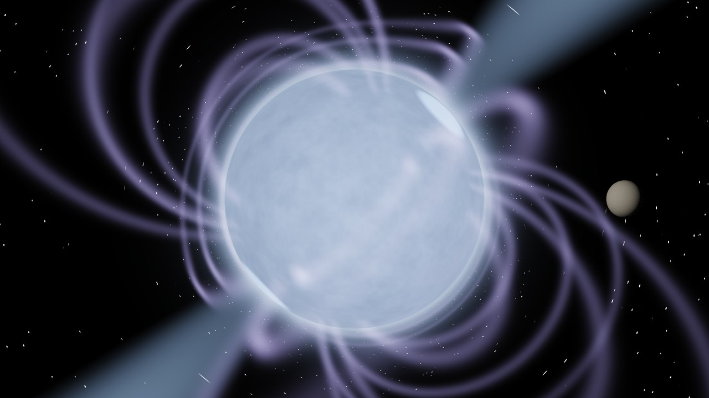
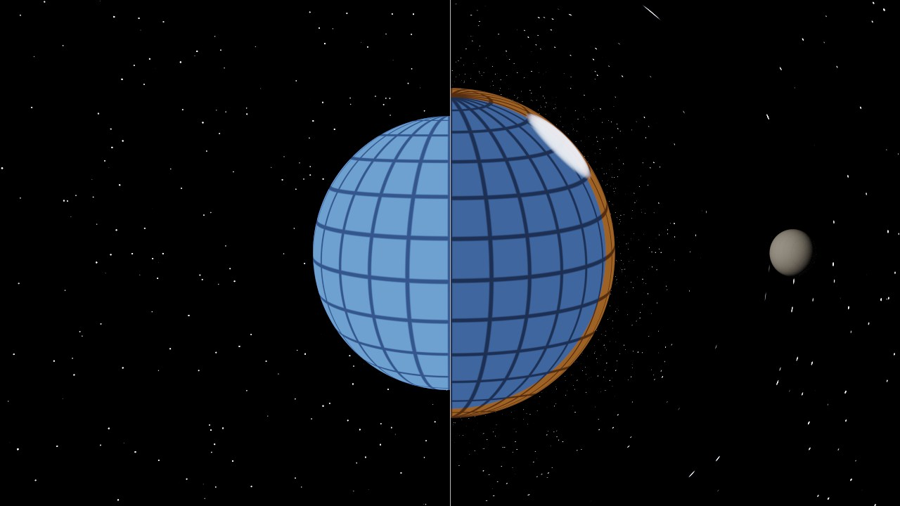

# Neutron Star: Physics, Visualization and Verification

A neutron star is a compact object without an event horizon: light leaves its surface and is bent
by its gravity on the way to the camera. The **Neutron Star** scene uses the same Schwarzschild light
paths as the black hole (see [black-hole.md](black-hole.md)); the difference is that rays can end on a
glowing surface. Units: G = c = 1, mass M.

| Realistic look: bent light, corona, field lines and pulsar beams | Diagnostic split view: straight light (left) and bent light (right) |
|---|---|
|  |  |

## 1. Physics

A typical neutron star has 1.4 solar masses and a radius of about 12 km. In units of M = GM/c² ≈ 2.07 km
this is **R ≈ 5.8M**: outside the photon sphere (3M), so every ray that reaches the camera leaves the
surface directly.

**Bending.** A photon leaving the surface at angle α from the outward normal has impact parameter
b = R sin α / √(1 - 2M/R) (static emitter, see black-hole.md §2). The angle ψ between the emission point's
normal and the direction to a distant observer follows from the orbit equation (2) of black-hole.md:

    ψ(α) = ∫₀^{1/R} du / √(1/b² - u²(1 - 2Mu))

Beloborodov (2002) gives the simple approximation **1 - cos α = (1 - cos ψ)(1 - 2M/R)**.

**How much of the surface is visible.** The farthest visible point is reached by a photon leaving
tangentially (α = 90°). Without gravity ψ_max = 90° and exactly half the surface is visible. Computed
from the exact integral:

| R / M | ψ_max (exact) | ψ_max (Beloborodov) | visible surface |
|---|---|---|---|
| 12 | 101.45° | 101.54° | 59.9 % |
| 8 | 109.17° | 109.47° | 66.4 % |
| **5.8** | **120.68°** | 121.76° | **75.5 %** |
| 4 | 152.57° | 180° | 94.4 % |
| 3.5 | 181.8° | – | 100 % (some points are seen twice) |

**Apparent size.** The star looks larger than it is: the outermost ray grazes the surface, so seen from
a static observer at distance r_o its angular radius is

    sin θ = (R / r_o) √(1 - 2M/r_o) / √(1 - 2M/R)

For R = 5.8M, r_o = 30M: **θ = 13.34°** instead of 11.15° for straight light; with a 40° vertical field
of view at 1280×720 that is **234.6 px** instead of **194.9 px**.

**Gravitational redshift.** Light climbing out of the potential is shifted by g = √(1 - 2M/R) = 0.809:
temperatures look 19 % lower and the brightness (specific intensity, which scales with g⁴) drops to 43 %.

**Pulses.** A hot spot at colatitude θ_s on a star whose spin axis is inclined by i to the line of sight
has cos ψ = cos i cos θ_s + sin i sin θ_s cos φ over the spin phase φ; its flux is proportional to
cos α · d(cos α)/d(cos ψ). For θ_s = 45°, i = 60° (relative to the maximum):

| phase | 0° | 60° | 120° | 150° | 180° |
|---|---|---|---|---|---|
| straight light | 1.000 | 0.683 | 0.049 | **0** | **0** |
| exact (R = 5.8M) | 1.000 | 0.795 | 0.386 | 0.235 | **0.179** |
| Beloborodov | 1.000 | 0.795 | 0.384 | 0.234 | 0.179 |

Without bending the spot would vanish for about 40 % of each turn; with bending it never disappears.
(Pechenick, Ftaclas & Cohen 1983 for the exact treatment; Beloborodov 2002 for the approximation.)

## 2. Visualization

The scene has two looks. The default is a realistic picture of a pulsar; the *Diagnostic view* switch
replaces it with a colouring that makes the invisible effect of bending obvious (and is what the
measurements below use):

| Element | Kind | Why |
|---|---|---|
| Light bending, apparent size, lensed star field | physical | exact ray marching |
| Gravitational redshift of the surface (g⁴ brightness, g · temperature) | physical | uniform dimming / reddening |
| Hot surface: black-body colour, gentle mottling, limb darkening I ∝ 0.35 + 0.65 μ (μ = cosine of the emission angle) | physical model, simplified | a ~10⁶ K atmosphere is darker towards the limb; the true colour of such a hot surface is blue-white |
| Hot polar caps at the magnetic poles | physical model, simplified | the classic pulsar picture; they spin into view and, thanks to bending, never fully disappear |
| Corona: a thin glowing layer, density ∝ exp(-(r - R) / 0.1R) | artistic | gives the limb a halo; sampled along the bent ray |
| Dipole magnetic field lines r = L sin²θ (θ from the magnetic axis), three shells L = 1.6R, 2.5R, 3.4R in six planes | physical shape, artistic glow | the field of a magnetized star; turns with the star; sampled along the bent ray, so it is lensed |
| **Diagnostic view:** hidden-region colouring of the surface: orange where straight light from the camera can never reach (n · toCamera < R / distance), blue elsewhere, with a latitude–longitude grid | diagnostic | every orange pixel is a part of the star that only bent light shows |
| **Split view**: left half straight light, right half bent light, same frame | diagnostic | direct comparison without toggling |
| Pulsar beams: glowing cones along the magnetic axis (switch *Pulsar beams and field lines*) | artistic | shows where the radiation goes; the glow is sampled along the bent ray, so the beams look bent near the star |

The star spins with *Play animation*, so the hot caps, field lines and beams turn with it.

## 3. Implementation

- `marchCompactObject` in `pathtrace.comp` handles both black holes and neutron stars: with gravity it
  integrates the light path (RK4, as for the black hole), without gravity it takes the same steps along a
  straight line. Each chord is checked against the star's surface sphere (for a black hole without gravity,
  the horizon sphere 2M), the accretion disk and the scene geometry (ray query). The photon-sphere capture
  rule is only used for a black hole with gravity.
- The scene data is a `CompactObject` (black hole: surface radius 0; neutron star: radius, spin period,
  magnetic tilt). The frame UBO carries it in three vec4s, plus the display flags.
- `surfaceEmission` gives the surface radiance (realistic or diagnostic, chosen by a flag bit), times g⁴ with gravity;
  `magnetosphereGlow` adds the corona, field lines and beams for each chord of the ray (two samples per chord,
  with early outs beyond the outermost field line), so the glow costs little: the scene still renders in ~15 ms.
- *Split view*, *Pulsar beams and field lines* and *Diagnostic view* are switches in the Scene panel; the star
  spins with *Play animation*.

## 4. Verification

`NeutronStarTest` (`./gradlew test`), M = 1:

| Check | Integrator | Exact |
|---|---|---|
| ψ for R = 5.8M, α = 90° (farthest visible point) | 120.67482° | 120.67482° |
| ψ for R = 8M, 12M (α = 45° and 90°) | all equal to 5 decimals | quadrature |
| Visible surface for R = 5.8M | 75.5 % | 75.5 % |
| Apparent angular radius from 30M | 13.34177° | 13.34141° (formula) |
| Same without gravity | 11.14738° | asin(R/r) = 11.14738° |

On the GPU (scene **Neutron Star**, *Diagnostic view* on, animation and beams off, camera at 30M, 40° vertical field of view),
radius measured from the image center in four directions with sub-pixel edge detection:

| | Rendered | Theory |
|---|---|---|
| Radius with gravity | **234.8 px** (234.7 … 234.8) | 234.6 px |
| Radius without gravity | **194.9 px** (194.9 … 195.0) | 194.9 px |
| Pixels showing the hidden region (orange) | 16 014 with gravity, **0** without | 0 without gravity |

Performance on an RTX 5060 Ti: about 15 ms GPU time per frame (~67 frames per second).

## Limits

- The star is treated as static spacetime (Schwarzschild); its rotation only moves the surface pattern
  (no frame dragging, no Doppler shift from the spinning surface, no oblate shape).
- The pulse profile table above is computed, not measured from the render (no light curve plot yet).
- Bounced and shadow rays are straight, as in the black hole scene.
